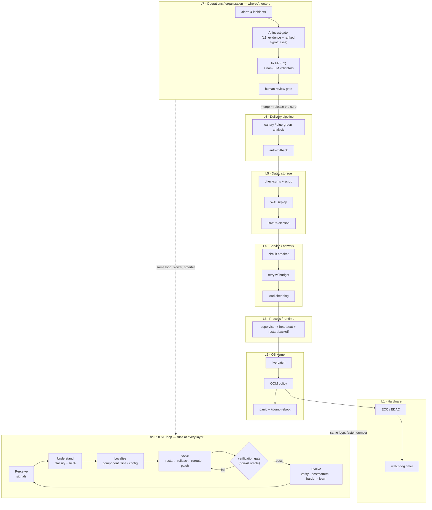

# Reference Architecture — the PULSE Framework for Self-Healing Software

**Status:** v1.0 (`#Step003`) · **Sources:** synthesis of dossiers 01–04 (`docs/research/00-synthesis.md`) · **Prototype:** `prototypes/pulse-app/` (all five scenarios PASS)

## 1. The one-paragraph version

A self-healing system is a **stack of healing loops**, one per layer, each doing the same five things — Perceive, Understand, Localize, Solve, Evolve (the **PULSE loop**, Decision 001). The loops at the bottom (hardware, kernel, storage) are fast, dumb, and proven; the loops at the top (delivery, operations) are where AI now enters as the *decide* stage. Two rules hold everywhere: **nothing counts as healed until a non-AI oracle says so** (the Solve→Evolve verification gate), and **the healer itself must be bounded** (backoff, restart intensity, blast-radius caps) so it can never harm the patient.

## 2. The stack diagram

**How to read it:** every layer box is a complete healing loop in its own right (see dossier 02's unifying table and dossier 03's toolbox). Escalation flows *up* (restart fails → rollback → human), signals flow *down* from the AI-era layer into every lower loop's sensors. The PULSE loop is the invariant shape — the layers differ only in speed, intelligence, and blast radius.

## 3. Component model (the AI-era layer, L7, expanded)

| Component | Responsibility | Verified exemplar |
|---|---|---|
| **Signal bus** | heartbeat, metrics, logs, traces, deploy/change events in one queryable place | OpenTelemetry (D02[34]); PagerDuty MCP server (D04[3]) |
| **Detector** | threshold + anomaly detection on the golden signals | Prometheus alerts (D02[32]); Bits on *every* alert (D04[2]) |
| **Investigator (L1)** | autonomous evidence collection → ranked root-cause hypotheses with confidence | incident.io Investigations (D04[4]); RCACopilot, 0.766 accuracy (D03[50]) |
| **Localizer** | map hypothesis to component/line/config/dependency | Agentless hierarchical localization (D01[24]); AutoCodeRover AST search (D01[25]) |
| **Solver portfolio** | restart · rollback · reroute · scale · patch — each tagged reversibility + blast radius | Resolve bounded rollbacks (D04[14]); agentic autofix (D04[17]) |
| **Verification oracle** | non-LLM: tests, SAST/CodeQL re-run, metric steady-state, golden request | CodeQL re-run (D04[17]); Snyk SAST screen (D04[18]); TestGen-LLM 73% acceptance (D04[30]) |
| **Gatekeeper** | autonomy policy: which rung (L0–L4) may act on which action class | PR-gated healing (D04[4][10]); rate caps after Anthropic's 200-workload incident (D04[31]) |
| **Learning store** | human-validated postmortems, runbook updates, policy/model updates | self-updating runbooks (D04[3]); RCACopilot incident memory (D03[50]) |

## 4. The autonomy ladder is part of the architecture

The Gatekeeper advances an action class up the ladder only with evidence (D04 rollout ladder):

| Rung | May do | May never do (yet) |
|---|---|---|
| L0 Observe | read telemetry | write anything |
| L1 Investigate | produce evidence-cited RCA | change systems |
| L2 Propose | open fix PRs after non-LLM validation | merge its own PR |
| L3 Act (bounded) | pre-authorized reversible actions (restart/rollback/scale), rate-capped | irreversible actions; anything novel |
| L4 Close loop | *(no verified production deployment — keep designing for it, don't claim it)* | — |

## 5. Instantiations

| | Small business ($0–50/mo) | Enterprise |
|---|---|---|
| L7 | on-call human + optional read-only LLM summarizer | AI investigator + PR-gated fix agents |
| L6 | platform health-check-gated deploys w/ auto-rollback (Render-style, D04[39]) | Argo/Flagger canary analysis (D02[29][30]) |
| L5 | managed-DB PITR + restic restore drills (D04[40]) | ZFS/consensus/WAL as shipped |
| L3–L4 | k3s pod restarts (D04[36]); Uptime Kuma + dead-man's-switch (D04[34][35]) | full service-mesh resilience (D02[6][7]) |
| L1–L2 | backups + ECC RAM + watchdogs, as shipped by hardware/OS | live patching (D03[1]–[5]), eBPF sensing/enforcement (D03[17]–[21]) |
| Prototype mapping | `prototypes/pulse-app` *is* this row in miniature | `prototypes/pulse-app` + PR-gate + canary = the same skeleton |

## 6. Architecture rules (binding, from the axioms + corpus)

1. **Heal at the lowest sufficient layer**; escalate upward only on repeated failure (restart intensity → rollback → human). *(A5, D02[1])*
2. **The verification gate is mandatory** — no Solve output reaches Evolve without a non-AI oracle verdict. *(A6, D04[17][18][30])*
3. **The healer is bounded**: backoff schedules, MaxR/MaxT intensity limits, action budgets, rate caps enforced in infrastructure, not prompts. *(A3, D02[22], D04[31])*
4. **Monitoring must be layered and out-of-band**: heartbeat (liveness) + golden request (correctness); self-reported health alone is not an oracle. *(A4, Decision 005)*
5. **Diagnosis may be autonomous; code-change is PR-gated; actuation only for pre-authorized reversible classes.** *(D04 §governance, OWASP LLM06 D04[47])*
6. **Every heal event is an Evolve artifact**: logged with MTTR, triage, and postmortem hook — healing without learning is just rebooting. *(A2, D01[3])*
7. **Declare desired state** wherever possible (reconciliation beats imperative repair scripts). *(A7, D02[19][20])*
