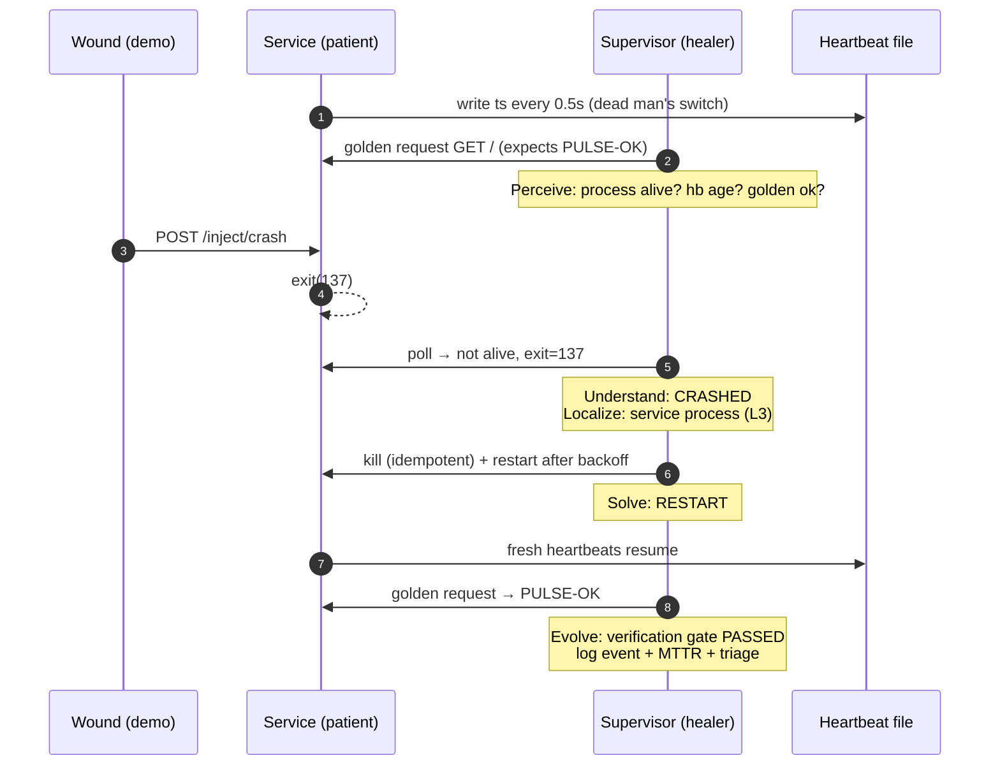
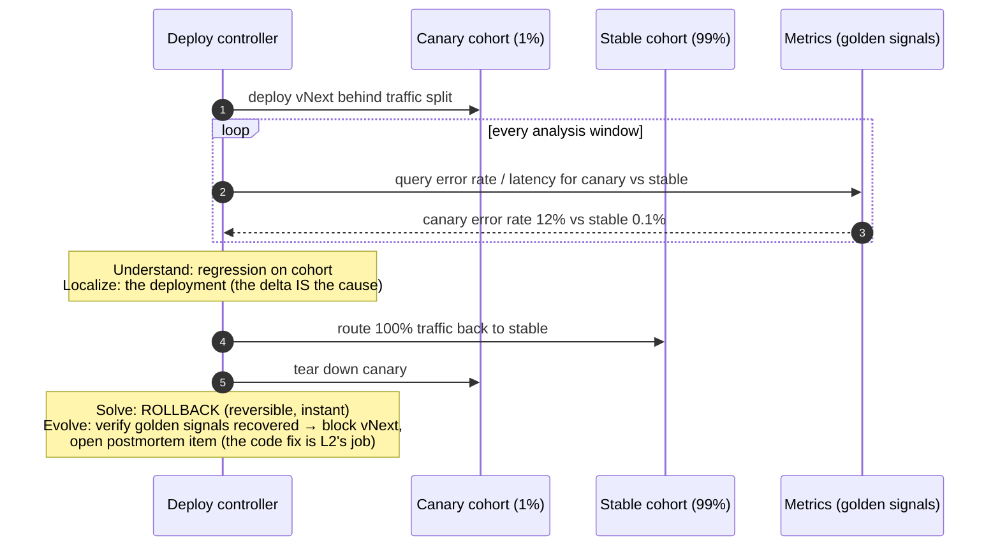
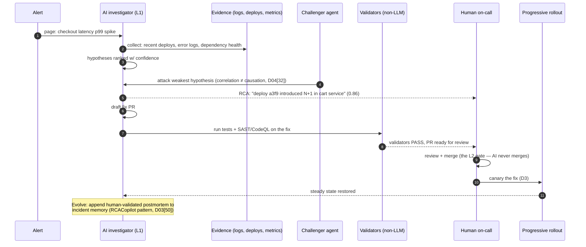
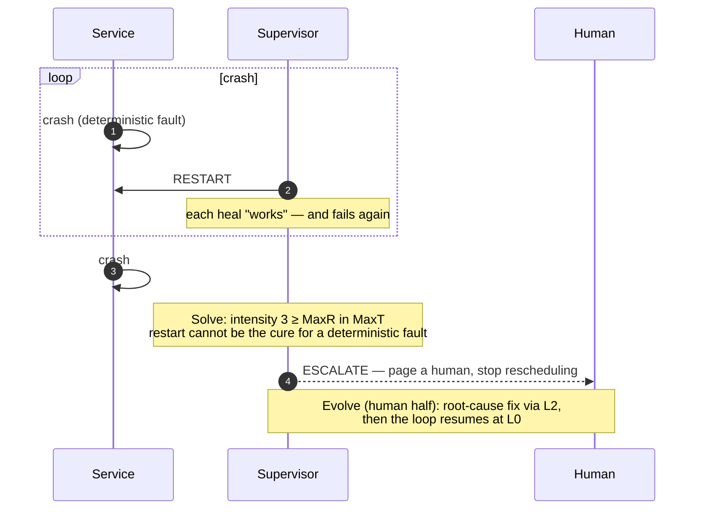
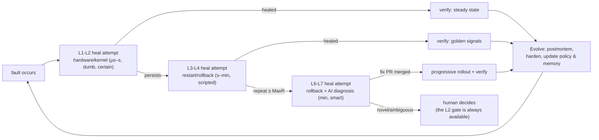

# Sequence Diagrams — the PULSE Framework

**Status:** v1.0 (`#Step003`) · All diagrams mermaid (GitHub-renderable, rule R3). Abstraction level noted per diagram; sources are dossier citations.

---

## D1 · Baseline heal: crash → supervised restart (L0, no AI)

**Level:** single host, process/runtime layer (L3). **Source of truth:** `prototypes/pulse-app/supervisor.py`. **Lineage:** OTP supervision (D02[1]), systemd `Restart=` (D02[7]), kubelet probes (D02[21][22]).



**Why this shape:** the supervisor *outlives* the supervised (Decision 003); the oracle is layered — liveness (heartbeat) **and** correctness (golden request) — because a hung-but-alive process or a zombie that answers nothing are different wounds (Decision 005).

---

## D2 · Hang → dead-man's-switch heal (liveness ≠ aliveness)

**Level:** process layer. **Source of truth:** `service.py` hang fault. **Lineage:** `sd_notify("WATCHDOG=1")` (D02[7][8]), Healthchecks.io (D04[35]), hardware watchdog `/dev/watchdog` (D03[9][10]).

```mermaid
sequenceDiagram
    autonumber
    participant S as Service
    participant HB as Heartbeat file
    participant SUP as Supervisor

    Note over S,HB: healthy: hb age always &lt; 3s
    S->>S: inject hang → heartbeat thread stops,<br/>handlers sleep 60s
    SUP->>HB: read ts → age grows 3s, 3.5s, 4s…
    SUP->>S: golden request → timeout (2s)
    Note over SUP: Perceive: alive=true BUT hb stale + golden dead<br/>Understand: HUNG (not crashed — no exit)<br/>Localize: event loop / heartbeat thread
    SUP->>S: SIGTERM → (1.5s) → SIGKILL → restart
    Note over SUP: Solve→Evolve: same gate as D1
```

**Why this matters:** process-liveness-only monitoring calls this HEALTHY. The dead man's switch is the cheapest oracle that catches it — and it is the *same pattern* at every scale, from systemd services to cron jobs to Raft leader election (D03[28]).

---

## D3 · Deployment regression → canary auto-rollback (Solve = routing, not repair)

**Level:** delivery pipeline (L6). **Lineage:** canary + metric analysis (D02[27]), Argo Rollouts / Flagger (D02[29][30]), Render health-check-gated deploys (D04[39]) — the highest-value self-healing a small business can buy.



**Why rollback before diagnosis:** when the *change* is the failure class (the dominant one — most outages are caused by change, D02 §5), removing the change is faster and safer than diagnosing it. Diagnosis continues offline at L7.

---

## D4 · AI triage → human-gated fix (L1 → L2, the verified 2025–26 pattern)

**Level:** operations (L7). **Lineage:** incident.io Investigations (D04[4]), Bits Investigation (D04[2]), Claude Tag first responder (D04[31]), agentic autofix + CodeQL re-run (D04[17]), Snyk SAST screen (D04[18]).



**Why the gates:** this is exactly where the industry frontier stops — autonomous investigation and drafting are shipping; the merge and any production actuation stay behind human + non-LLM gates (D04 §governance; OWASP LLM06 D04[47]).

---

## D5 · Restart storm → escalation to human (the healer heals itself by refusing)

**Level:** runtime layer, policy stratum. **Source of truth:** `supervisor.py` crashloop scenario (PASS). **Lineage:** OTP MaxR/MaxT (D02[1][2]); "cascading restarts do not work" (Wiger, D02[1]); axiom A3.



**Why escalation is a heal:** unbounded retry converts a fault into an outage *plus* load storm (243× amplification math, D02[10]). Refusing to thrash — and paging — is the bounded healer's correct terminal action; it is also where the AI era's L2 loop (D4) picks the work up.

---

## D6 · Layered escalation — the full ladder in one picture

**Level:** whole system. **Summary of D1–D5 plus the research corpus:**


