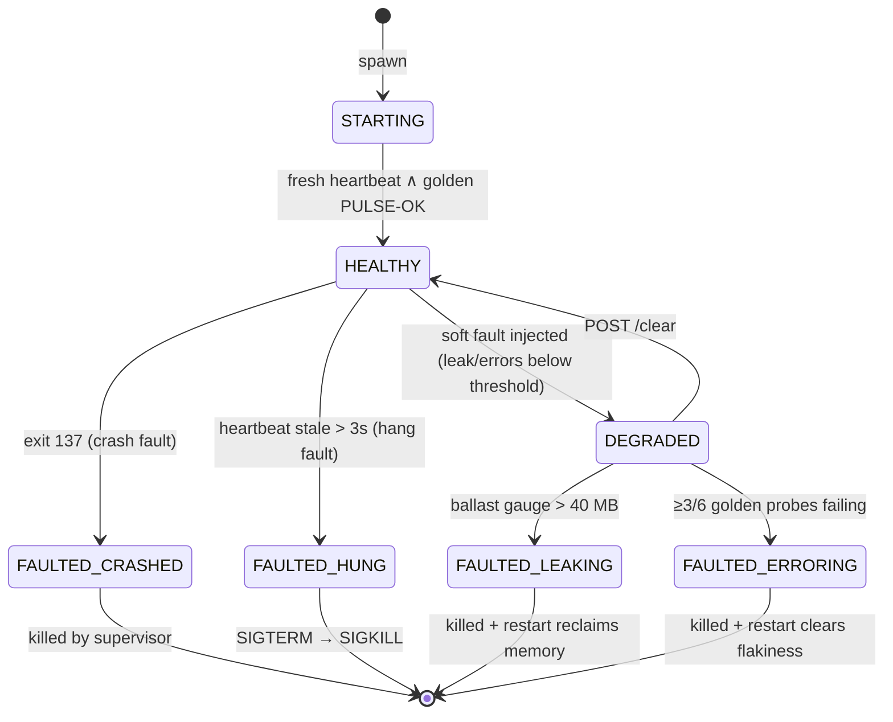

# State & Workflow Model — the PULSE prototype

**Date:** 2026-11-13 · **Companion:** [use-case catalog](use-case-catalog.md) · [interactive model](../animations/pulse-interactive.html) · All states/transitions below mirror `prototypes/pulse-app/supervisor.py` and `service.py` exactly (line-verified 2026-11-13).

## 1. The two machines

The system is two coupled state machines: the **patient** (service, which fails) and the **healer** (supervisor, which runs PULSE). The healer's Perceive stage samples the patient's state; the patient never knows the healer exists except through signals (being killed/restarted).

### 1.1 Patient (service) — states as *observed by the oracle*



| State | Observable definition | Code |
|---|---|---|
| STARTING | process spawned, heartbeat not yet fresh | `spawn()` → `verify()` polling |
| HEALTHY | alive ∧ hb_age ≤ 3 s ∧ gauges under threshold ∧ golden OK | `understand()` → `"HEALTHY"` |
| DEGRADED | faults set but below action thresholds (e.g. leak growing, errors at 20–49 %) | `service.py` faults set; `/health` reports `DEGRADED` |
| FAULTED_CRASHED | `poll() is not None`, exit 137 | `understand()` rule 1 |
| FAULTED_HUNG | alive ∧ (hb missing ∨ hb_age > 3 s) | `understand()` rule 2 |
| FAULTED_LEAKING | `ballast_mb > 40` | `understand()` rule 3 |
| FAULTED_ERRORING | full 6-probe window ∧ failure rate ≥ 50 % | `understand()` rule 4 |

### 1.2 Healer (supervisor) — the PULSE workflow machine

```mermaid
stateDiagram-v2
    [*] --> PERCEIVING: spawn + await readiness
    PERCEIVING --> PERCEIVING: tick 0.3s, classify HEALTHY
    PERCEIVING --> SOLVING: classify ≠ HEALTHY (within 15s budget)
    SOLVING --> ESCALATED: restarts_in_window ≥ MaxR(3)/30s
    SOLVING --> RESTARTING: else — kill + backoff(1,2,4,8s) + respawn
    RESTARTING --> VERIFYING: child up
    VERIFYING --> HEALED: hb fresh ∧ golden OK ≤ 10s
    VERIFYING --> FAILED: 10s budget exhausted
    HEALED --> PERCEIVING: event logged (Evolve)
    FAILED --> PERCEIVING: next classify will re-Solve
    ESCALATED --> [*]: page human; halting rescheduling
```



| State | Semantics | Code |
|---|---|---|
| PERCEIVING | sample layered oracle every `tick_s=0.3` | `perceive()`, loop in `run_scenario` |
| SOLVING (decide) | prune restart window → intensity check → act | `solve()` |
| RESTARTING | SIGTERM→(1.5 s)→SIGKILL, sleep backoff, respawn | `kill_child()` + `solve()` |
| VERIFYING | the gate: freshness + correctness, `ready_timeout_s=10` | `verify()` |
| HEALED | event emitted with MTTR + triage (Evolve) | `_event()` |
| ESCALATED | terminal for the healer — human is now part of the loop (axiom A11) | `solve()` MaxR branch |
| FAILED (to heal) | verification budget exhausted; loop re-enters Perceive, next Solve increments intensity | `verify()` → `run_scenario` |

## 2. The stateful bits people miss

1. **The restart window is the escalation state.** `restart_times` (timestamps, pruned to `restart_window_s=30`) is what turns repeated heals into an escalation. It is the OTP MaxR/MaxT idea in 6 lines (`supervisor.py:solve`).
2. **The error-rate window needs to fill before it can fire.** `golden_window` is a 6-slot deque — ERRORING is unreachable for the first ~1.8 s of sampling (`perceive()` appends one probe per tick). Deliberate: thresholds need evidence.
3. **The heartbeat file outlives the process briefly.** After a kill, a stale-but-fresh file can exist; that's why `verify()` requires heartbeat freshness **and** golden OK — the golden request can only succeed against a live listener (DR005).
4. **Escalation is a *heal*.** ESCALATED is a PASS verdict in the crashloop scenario — the healer's correct terminal action for deterministic faults is refusing to thrash (axiom A3).

## 3. Timing model (all in `CONFIG`, supervisor.py)

| Constant | Value | Role |
|---|---|---|
| `tick_s` | 0.3 s | Perceive cadence |
| heartbeat write | 0.5 s (`service.py`) | dead-man's-switch period |
| `heartbeat_timeout_s` | 3.0 s | HUNG threshold (6 missed beats) |
| `golden_timeout_s` | 2.0 s | per-probe timeout (hangs stall 60 s server-side) |
| `leak_limit_mb` | 40 MB | gauge threshold (8 MB per golden probe while leaking) |
| `error_window` / threshold | 6 probes / 50 % | error-rate rule |
| `backoff_schedule` | 1, 2, 4, 8 s (capped) | kubelet-style damping |
| `max_restarts_in_window` / `restart_window_s` | 3 / 30 s | MaxR/MaxT |
| `detect_budget_s` | 15 s | Perceive deadline per wound |
| `ready_timeout_s` | 10 s | Verify budget |

## 4. Evolve artifact schema (`healing-log.jsonl`, one JSON object per heal)

```json
{"scenario": "...", "fault_class": "CRASHED|HUNG|LEAKING|ERRORING",
 "localized": "<component + layer>", "action": "RESTART#n|ESCALATE",
 "detected": true, "healed": true, "escalated": false, "mttr_ms": 1621,
 "outcome": "PASS|FAIL", "note": "…", "triage": {"hypotheses": [...], "gate": "…"},
 "config": {…}}
```

The event log *is* the Learning interface: downstream (human postmortem, future fine-tuning, dashboard) consumes exactly these records (use-cases A12–A13).

## 5. Workflow ↔ use-case ↔ interactive page map

| Workflow | Use cases | Mirrored in `pulse-interactive.html` |
|---|---|---|
| W1 baseline heal (scenario driver) | A1–A3, A7–A13, C1–C4 | wound buttons → animated classifier → backoff → gate → log |
| W2 crashloop escalation | A10, A16, C5 | restart meter filling to MaxR → ESCALATED banner |
| W3 readiness/verify | A6, A11 | heartbeat bar + golden-probe lamp on the patient card |
| W4 event emission | A12–A13 | streaming console lines + triage popover |
