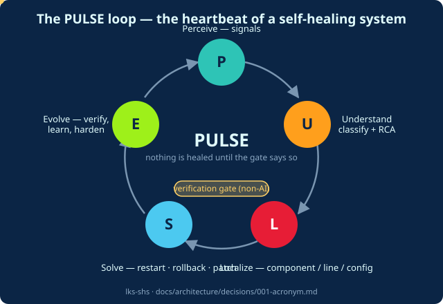

# Self-Healing Software in the AI Era — a 9-part series

> **The pitch:** self-healing wasn't invented — it was *layered*, over seventy years, from ECC memory to Kubernetes. What AI changes is not the loop but the **decide stage**. This series shows you the whole stack, the evidence, a working framework (**PULSE**), a runnable prototype, and honest playbooks for two-person shops and enterprises.

**Where to start:** Part 1 if you want the story · Part 4 if you want the framework · Part 5 if you want to *run* it · Parts 6–7 if you have a budget to spend (or not).

| # | Post | For whom | One-line takeaway |
|---|---|---|---|
| 1 | [Seventy Years of Self-Healing](01-seventy-years-of-self-healing.md) | everyone | Every pre-AI mechanism is the same observe→decide→act loop; the decide stage stayed frozen until now |
| 2 | [The Systems Layer](02-the-systems-layer.md) | system programmers | Kernels and hardware have self-healed for decades — live patching, watchdogs, self-repairing storage |
| 3 | [What Actually Shipped in the AI Era](03-the-ai-era-what-actually-shipped.md) | engineers + buyers | Autonomous *investigation* is a product category; autonomous *remediation* is bounded, gated, and rare |
| 4 | [The PULSE Framework](04-the-pulse-framework.md) | architects | Perceive · Understand · Localize · Solve · Evolve — one loop at every layer, with a verification gate |
| 5 | [PULSE in ~600 Lines of Python](05-pulse-in-python.md) | builders | A woundable service + an external supervisor: crash it, hang it, leak it — watch it heal |
| 6 | [The Small-Business Playbook](06-the-small-business-playbook.md) | 1–20 person shops | Real self-healing for $0–50/month: dead-man's-switch, auto-rollback, restore drills |
| 7 | [The Enterprise Playbook](07-the-enterprise-playbook.md) | platform/SRE leads | The autonomy ladder L0–L4, governance that survives audits, and the FinOps math |
| 8 | [Risks, Anti-Patterns, and the Road to L4](08-risks-anti-patterns-road-to-l4.md) | everyone, especially buyers | The 200-workloads-in-90-seconds story, correlation≠causation, and what nobody has shipped yet |

## The three ideas that hold the series together

1. **One loop, every layer.** From a watchdog timer to an AI incident agent, everything is Perceive → Understand → Localize → Solve → Evolve. The layers differ in speed, intelligence, and blast radius — not in shape. *(Part 1, Part 4)*
2. **The verification gate is non-negotiable.** Nothing counts as healed until a *non-AI* oracle — tests, SAST re-run, steady-state metrics, a golden request — says so. This is the single most consistent finding across 180 verified sources. *(Part 3, Part 4, Part 8)*
3. **AI builds better than it heals.** AI-as-builder (fix PRs, tests, fuzz targets, runbooks) is production-proven and cheap; AI-as-healer is proven only in its observe/diagnose half plus *reversible, pre-authorized* actions. Design for that frontier, not the press release. *(Part 3, Part 7, Part 8)*

## Try it live (no install)

Open [`docs/animations/pulse-interactive.html`](animations/pulse-interactive.html) — a single self-contained file that simulates the real supervisor faithfully (same states, thresholds, MaxR/MaxT escalation, and log lines). **Wound the service with the buttons and watch the loop heal it.** The model behind it: [`state-workflow-model.md`](../architecture/state-workflow-model.md) · every behavior maps to a shipped use case: [`use-case-catalog.md`](../architecture/use-case-catalog.md).

## How this series was built (and why you can trust it)

- Every claim traces to a **numbered, URL-verified source** in the research dossiers: [`docs/research/`](../research/README.md) — 180 sources, all fetched 2026-11-09, unverifiable claims marked `[UNVERIFIED]` and excluded.
- Design choices carry **decision records with 3–5 alternatives and trade-offs**: [`docs/architecture/decisions/`](../architecture/decisions/001-acronym.md).
- The prototype is runnable in one command and its evidence log is committed: [`prototypes/pulse-app/`](../../prototypes/pulse-app/README.md).
- Attribution discipline: ideas are credited to their originators — MAPE-K to Kephart & Chess / IBM, "let it crash" to Joe Armstrong, the circuit breaker to Michael Nygard, chaos engineering to Netflix and Basiri et al., and so on throughout.

## Video companions

Each part links a narrated video (rendered from this repo's pipeline — see `docs/video/`). Videos and posts cross-reference the same dossier citations, so the two tell one story.

## Reading time

~15 min for the framework core (1, 3, 4) · ~40 min for everything · Part 5 assumes you can read Python · Parts 6–7 assume you can read an invoice.
