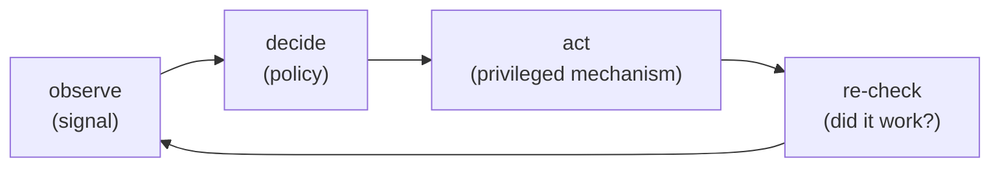
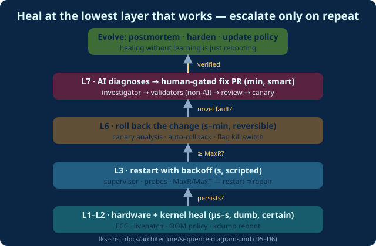

# Part 1 · Seventy Years of Self-Healing

*Series: [Overview](00-series-overview.md) · **Part 1** · [Part 2](02-the-systems-layer.md) · [Part 3](03-the-ai-era-what-actually-shipped.md) · [Part 4](04-the-pulse-framework.md)*
**Audience:** everyone · ~8 min · Video companion: [`docs/video/01-seventy-years.mp4`](../video/01-seventy-years.mp4) — 2:01 narrated

> In 2003, Joe Armstrong wrote down the most-quoted — and most-misquoted — number in reliability engineering. The famous "nine nines" (99.9999999% availability) claimed for the Ericsson AXD301 Erlang switch turns out, **in Armstrong's own thesis**, to come from "a power-point presentation … though how these figures had been obtained was not documented." [1] That is your first lesson in this field: *healing claims are cheap; healing evidence is precious.*

## The three waves

| Wave | Era | Core idea | Representative artifact |
|---|---|---|---|
| **1 · Engineered recovery** | 1956–1999 | Design the healing *in advance*, prove it works | von Neumann's redundancy voting (1956) [2], Dijkstra's self-stabilization (1974) [3], Randell's recovery blocks (1975) [4], Gray & Reuter's WAL transactions (1993) [5], Castro & Liskov's BFT (1999) [6] |
| **2 · Autonomic / self-adaptive** | 2001–2012 | Systems *manage themselves* via feedback loops | IBM's autonomic computing manifesto (Horn, 2001) [7], **MAPE-K** (Kephart & Chess, 2003) [8], Rainbow (Garlan et al., 2004) [9], Erlang/OTP in production [1] |
| **3 · Improvised repair** | 2012–now | *Synthesize* the fix at runtime, measure how often it works | GenProg: 55/105 bugs at ~$8 each (2012) [10], AlphaRepair (2022) [11], SWE-bench agents (2024–26) [12] |

The waves stack — none replaced the previous one. Your Kubernetes node still uses wave-1 ECC memory and wave-1 consensus under a wave-2 reconciliation loop, with wave-3 agents reading the alerts.

## Everything is the same loop

Strip the branding from any mechanism across those seventy years and you find one shape — **observe → decide → act → check**:

| System | Observe | Decide | Act |
|---|---|---|---|
| Erlang/OTP supervisor (1986–) | exit signals with reason | restart strategy + intensity limit | restart worker, escalate on breach [1] |
| Circuit breaker (Nygard, 2007) | rolling error/latency rate | threshold opens breaker | fail fast + fallback [13] |
| Kubernetes kubelet (2014–) | liveness/readiness probes | probe thresholds × policy | kill + restart, backoff 10s→300s [14][15] |
| ZFS (2005–) | checksum of every block | checksum mismatch | fetch good copy, **repair in place** [16] |
| Chaos Monkey (2011–) | steady-state metrics | hypothesis + abort rules | kill production instances — on purpose [17][18] |
| Canary analysis (Argo/Flagger) | cohort KPI deltas | promote-or-rollback rule | shift traffic back to stable [19][20] |

*(Full 15-system table: dossier 02; systems-layer detail in [Part 2](02-the-systems-layer.md).)*

## The naming moment: MAPE-K

When IBM's Paul Horn called for autonomic computing in 2001 — IT complexity outpacing human administrators — Kephart & Chess answered with the vocabulary the field still uses: systems should be **self-configuring, self-healing, self-optimizing, self-protecting**, built from managers running a **Monitor–Analyze–Plan–Execute loop over shared Knowledge** [7][8]. Every "AI ops agent" today that reads telemetry, reasons, and opens a PR is a MAPE-K descendant with a different brain.

## How it was done before AI — and where it broke

The pre-AI playbook solved two of the three halves of healing:

- ✅ **Sensing**: probes, heartbeats, checksums, the four golden signals [21]
- ✅ **Actuation**: restart, rollback, reroute, replay, re-elect, repair-in-place — battle-tested by 2010–2020
- ❌ **The decide stage**: frozen at design time — hand-tuned thresholds, human-written policies, ending in **a paged human with a runbook at 3 a.m.**

Four failure modes of that frozen decide stage, all documented:

1. **Restart is not repair.** A deterministic bug crash-loops; "cascading restarts do not work" — Wiger's finding from the AXD301 itself [1]. The defect ships again tomorrow.
2. **Naive retry is an outage multiplier.** A 5-layer call stack with 3 retries per layer can amplify load on a failing dependency **243×** [22].
3. **Static policy rots.** Netflix retired Hystrix — the library that industrialized circuit breakers — for *adaptive* limits, because hand-tuned thresholds age badly [23].
4. **Alert fatigue is structural.** Distributed systems emit event storms; entire product categories exist to compress them [24].

Even the best pre-LLM "AI healing" was narrow and human-gated: Meta's **Getafix** learned fix patterns from history (top-1 exact fix 12–91% by bug class) and **SapFix** generated, tested, and *proposed* end-to-end crash patches — always for an engineer to approve [25][26]. That human gate is the exact line the current AI era is negotiating. ([Part 3](03-the-ai-era-what-actually-shipped.md).)

> **The thesis of this series:** the actuation layer was already solved. What AI changes is the decide stage — for the first time, diagnosis and repair-synthesis can be *improvised at runtime* instead of *enumerated at design time*. The engineering challenge is transplanting that intelligence **inside** the old loop's safety envelope: blast-radius limits, verification gates, human approval. Not bolted on outside it.

## References & attribution

Full sourcing with access dates: [`docs/research/01-academic-foundations.md`](../research/01-academic-foundations.md) · [`docs/research/02-pre-ai-foundations.md`](../research/02-pre-ai-foundations.md)

1. Joe Armstrong, *Making Reliable Distributed Systems in the Presence of Software Errors* (KTH PhD thesis, 2003) — https://erlang.org/download/armstrong_thesis_2003.pdf
2. J. von Neumann, *Probabilistic Logics and the Synthesis of Reliable Organisms from Unreliable Components* (1956)
3. E. W. Dijkstra, *Self-stabilizing systems in spite of distributed control*, CACM 17(11), 1974 — https://dl.acm.org/doi/10.1145/361179.361202
4. B. Randell, *System structure for software fault tolerance*, IEEE TSE, 1975 — https://doi.org/10.1109/TSE.1975.6312840
5. J. Gray & A. Reuter, *Transaction Processing: Concepts and Techniques* (1993)
6. M. Castro & B. Liskov, *Practical Byzantine Fault Tolerance*, OSDI '99 — https://www.usenix.org/conference/osdi-99/practical-byzantine-fault-tolerance
7. Paul Horn, *Autonomic Computing: IBM's Perspective on the State of Information Technology* (2001)
8. J. Kephart & D. Chess, *The Vision of Autonomic Computing*, IEEE Computer 36(1), 2003 — https://doi.org/10.1109/MC.2003.1160055
9. D. Garlan et al., *Rainbow: Architecture-Based Self-Adaptation with Reusable Infrastructure*, IEEE Computer 37(10), 2004 — https://doi.org/10.1109/MC.2004.100
10. C. Le Goues et al., *Fixing 55 out of 105 Bugs for $8 Each*, ICSE 2012 — https://doi.org/10.1109/ICSE.2012.6227211
11. C. S. Xia & L. Zhang, *AlphaRepair* (ESEC/FSE 2022) — https://arxiv.org/abs/2207.08281
12. C. Jimenez et al., *SWE-bench*, ICLR 2024 — https://arxiv.org/abs/2310.06770
13. M. Nygard, *Release It!* (Pragmatic Bookshelf, 2007/2018) — circuit breaker, bulkhead, timeout, fail-fast
14. Kubernetes docs, *What is Kubernetes* — https://kubernetes.io/docs/concepts/overview/what-is-kubernetes/
15. Kubernetes docs, *Pod Lifecycle* (crash-loop backoff) — https://kubernetes.io/docs/concepts/workloads/pods/pod-lifecycle/
16. Oracle, *Self-Healing Data in a Redundant Configuration* (ZFS) — https://docs.oracle.com/cd/E36784_01/html/E36835/gazch.html
17. Izrailevsky & Tseitlin, *The Netflix Simian Army*, Netflix TechBlog, 2011 — https://netflixtechblog.com/the-netflix-simian-army-16e57fbab116
18. A. Basiri et al., *Chaos Engineering*, IEEE Software 33(3), 2016 — https://arxiv.org/abs/1702.05843
19. D. Sato, *Canary Release*, martinfowler.com, 2014 — https://martinfowler.com/bliki/CanaryRelease.html
20. Argo Rollouts docs — https://argo-rollouts.readthedocs.io/en/stable/
21. R. Ewaschuk, *Monitoring Distributed Systems* (Google SRE book, ch. 6) — https://sre.google/sre-book/monitoring-distributed-systems/
22. M. Brooker, *Timeouts, retries, and backoff with jitter*, AWS Builders' Library, 2019 — https://aws.amazon.com/builders-library/timeouts-retries-and-backoff-with-jitter/
23. Netflix, *Hystrix* (maintenance-mode README) — https://github.com/Netflix/Hystrix
24. Dynatrace, *Causal AI use cases for modern observability* — https://www.dynatrace.com/news/blog/causal-ai-use-cases-for-modern-observability/
25. J. Bader, A. Scott, M. Pradel, S. Chandra, *Getafix: Learning to Fix Bugs Automatically*, OOPSLA 2019 — https://arxiv.org/abs/1902.06111
26. Jia, Mao & Harman, *Finding and fixing software bugs automatically with SapFix and Sapienz*, Facebook Engineering, 2018 — https://engineering.fb.com/2018/09/13/developer-tools/finding-and-fixing-software-bugs-automatically-with-sapfix-and-sapienz/

**Next:** [Part 2 — the systems layer: kernels that patch themselves while running →](02-the-systems-layer.md)
