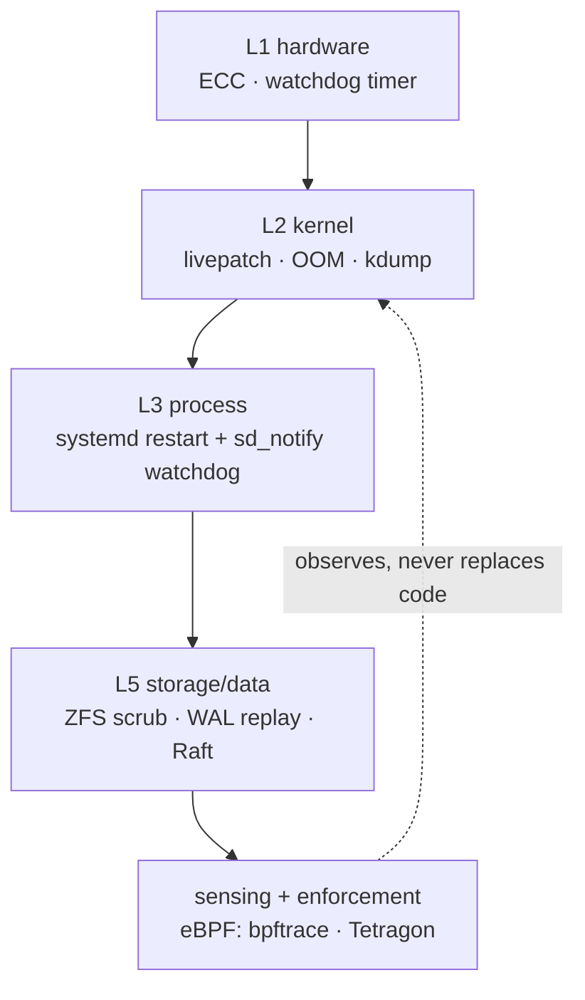

# Part 2 · Self-Healing in the Systems Layer

*Series: [Overview](00-series-overview.md) · [Part 1](01-seventy-years-of-self-healing.md) · **Part 2** · [Part 3](03-the-ai-era-what-actually-shipped.md)*
**Audience:** system programmers, infrastructure engineers · ~8 min · Video companion: [`docs/video/02-systems-layer.mp4`](../video/02-systems-layer.mp4) — 1:52 narrated

> The kernel under your web app right now can be **patched mid-flight, without rebooting, in about 0.7 milliseconds of interruption** — and this has been true since Ksplice (2009) proved 88% of kernel security vulnerabilities need no new code, just redirected function calls [1][2].

## The layered toolbox

Systems self-healing is a protection stack — each layer catches what the one below misses:

| Layer | Mechanism | Heals what | Key caveat |
|---|---|---|---|
| Hardware | ECC + EDAC + mcelog | bit flips, failing DIMMs; soft-offline bad pages | uncorrectable errors still fatal [3][4] |
| Kernel | live patching (KLP/kpatch/Ksplice) | CVEs in a running kernel | **data-structure semantic changes still need reboot** [1][2][5] |
| Kernel | `panic=` + kdump/kexec | unrecoverable panic → informative, bounded reboot | dump I/O takes minutes [6] |
| Kernel | OOM killer + `oom_score_adj` | system-wide memory exhaustion | heuristic amputation — can shoot the wrong process [7] |
| Process | systemd `Restart=` + `WatchdogSec=` | crashed **and hung** daemons | app must be instrumented (`sd_notify`) [8] |
| Storage | ZFS checksum + scrub | silent bit rot — repair in place from redundancy | no redundancy = detection only [9] |
| Data | PostgreSQL WAL replay | torn pages, crash consistency | assumes honest fsync + ECC RAM [10] |
| Coordination | Raft (etcd) | failed leader — re-elect, converge logs | majority loss = read-only [11] |
| Kernel/network | eBPF | safe, hot-loadable sensing + enforcement | observes and filters — cannot *replace* buggy kernel code [12] |

## Three deep details worth knowing

**1. The supervision chain is: hardware watches systemd, systemd watches the service.** `RuntimeWatchdogSec=` makes systemd ping the hardware WDT at half-interval; `WatchdogSec=` + `sd_notify("WATCHDOG=1")` makes the *service itself* the hang detector. Miss your keep-alive, and systemd SIGABRTs and restarts you [8]. This two-level pattern — immortal dumb watcher below, smart policy above — is the template for every healing design in this series.

**2. All live patchers share one hard wall.** Ksplice, kpatch, and the in-tree livepatch subsystem all refuse (or require hand-written transition code for) **semantic changes to persistent data structures** — the same undecidability wall dynamic-software-update research hit in the 1990s [1][2]. Lesson for AI-era dreams: an agent that "just patches the kernel" inherits this wall, not just the easy 88%.

**3. Prevention is the cheapest cure — and it's measurable.** ~70% of Microsoft CVEs [13] and ~70% of Chromium high-severity bugs [14] are memory-safety issues. Android wrote new code in Rust and watched its memory-safety share fall **76% (2019) → 24% (2024)** [15]. Meanwhile OSS-Fuzz + ClusterFuzz have fixed **36,000+ bugs across 1,000+ projects** with fully automated find→minimize→bisect plumbing [16][17]. Healing before the wound.

## Where AI actually entered systems work (verified examples only)

- **Pre-LLM, production:** Meta's **Getafix** auto-patched **53% of ~2,000 Instagram null-bugs** in one experiment; **SapFix** proposed end-to-end crash fixes with a human gate [18][19].
- **AI fuzzing that found a 20-year-old bug:** Google's OSS-Fuzz LLM pipeline found **CVE-2024-9143 in OpenSSL** — "likely present for two decades and … not discoverable with existing fuzz targets written by humans" [20]. By 2026, OSS-Fuzz pairs with DeepMind's **CodeMender** to deliver engineer-reviewed patches end-to-end [21].
- **First public AI-agent zero-day:** Project Zero + DeepMind's **Big Sleep** found an exploitable SQLite underflow that 150 CPU-hours of fuzzing had missed [22].
- **LLM syscall specs:** **KernelGPT** generated Syzkaller specs → 24 new kernel bugs, 11 CVEs, specs merged upstream [23].
- **Production incident triage:** Microsoft's **Triangle** multi-agent system (FSE 2025) lifted triage accuracy from 43.4% → 91.7% within 5 hops, deployed for tens of millions of users; **RCACopilot** hit 0.766 RCA accuracy on a year of real incidents [24][25].
- **Reality check:** on routine cloud infrastructure code (SWE-InfraBench, 2026), the best agent passes only **34%** of tasks [26]. AI excels at *finding* in systems code; routine infra edits still resist.

*(Attribution hygiene: "SuperHELM" and "KernelBiologist" circulate in AI-for-systems chatter but leave no verifiable trace — the dossier marks them [UNVERIFIED] and cites the real systems above instead [D03 §open questions]. This series does the same.)*

## References & attribution

Full sourcing: [`docs/research/03-systems-domain.md`](../research/03-systems-domain.md) · [`docs/research/02-pre-ai-foundations.md`](../research/02-pre-ai-foundations.md)

1. Linux kernel docs, *Livepatch (consistency model)* — https://docs.kernel.org/livepatch/livepatch.html
2. J. Arnold & M. F. Kaashoek, *Ksplice: Automatic Rebootless Kernel Updates*, EuroSys 2009 — https://ksplice.oracle.com/doc/ksplice.pdf
3. Linux kernel docs, *EDAC Devices* — https://www.kernel.org/doc/html/latest/driver-api/edac.html
4. mcelog.org, *Memory Errors* — https://www.mcelog.org/memory.html
5. SUSE, *Kernel Live Patching* (>95% of qualifying fixes live-patched) — https://documentation.suse.com/smart/systems-management/html/klp/index.html
6. Linux kernel docs, *Kdump* — https://docs.kernel.org/admin-guide/kdump/kdump.html
7. man7, *proc_pid_oom_score_adj(5)* — https://man7.org/linux/man-pages/man5/proc_pid_oom_score_adj.5.html
8. L. Poettering, *systemd for Administrators, Part XV: Watchdogs*, 2012 — https://0pointer.net/blog/projects/watchdog
9. OpenZFS docs, *Scrub and Resilver* — https://openzfs.github.io/openzfs-docs/Basic%20Concepts/Operations/Scrub%20and%20Resilver.html
10. PostgreSQL docs, *Reliability and the Write-Ahead Log* — https://www.postgresql.org/docs/current/wal-reliability.html
11. D. Ongaro & J. Ousterhout, *Raft* (2014) — https://raft.github.io/raft.pdf
12. ebpf.io, *What is eBPF?* — https://ebpf.io/what-is-ebpf/
13. MSRC (R. Levick, S. Fernandez), *We Need a Safer Systems Programming Language*, 2019 — ~70% of CVEs memory-safety
14. Chromium Security, *Memory Safety* — ~70% of high-severity bugs
15. Google Android Security, *Eliminating Memory Safety Vulnerabilities at the Source*, 2024 — https://security.googleblog.com/2024/09/eliminating-memory-safety-vulnerabilities-Android.html
16. OSS-Fuzz docs — https://google.github.io/oss-fuzz/
17. ClusterFuzz — https://github.com/google/clusterfuzz
18. Meta Engineering, *Getafix: How Facebook Tools Learn to Fix Bugs Automatically*, 2018 — https://engineering.fb.com/2018/11/06/developer-tools/getafix-how-facebook-tools-learn-to-fix-bugs-automatically/
19. Meta AI, *SapFix and Sapienz*, 2018 — https://ai.meta.com/blog/finding-and-fixing-software-bugs-automatically-with-sapfix-and-sapienz/
20. Google, *Leveling Up Fuzzing: Finding More Vulnerabilities with AI*, 2024 — https://security.googleblog.com/2024/11/leveling-up-fuzzing-finding-more.html
21. Google, *From Finding to Fixing*, 2026 — https://blog.google/security/from-finding-to-fixing-reducing-maintainer-burden-with-automated-patches/
22. Project Zero / DeepMind, *From Naptime to Big Sleep*, 2024 — https://projectzero.google/2024/10/from-naptime-to-big-sleep.html
23. Yang, Zhao & Zhang, *KernelGPT*, ASPLOS 2025 — https://arxiv.org/abs/2401.00563
24. Yu, Ma et al., *Triangle: Empowering Incident Triage with Multi-LLM-Agents*, FSE 2025 — https://www.microsoft.com/en-us/research/wp-content/uploads/2025/02/TRIANGLE_FSE25.pdf
25. Y. Chen et al., *RCACopilot*, EuroSys 2024 — https://arxiv.org/abs/2305.15778
26. Tarasova et al., *SWE-InfraBench*, 2026 — https://arxiv.org/abs/2606.05249

**Next:** [Part 3 — what actually shipped in the AI era →](03-the-ai-era-what-actually-shipped.md)
