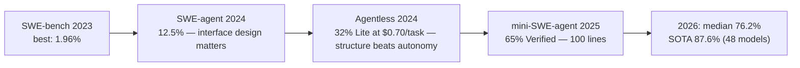
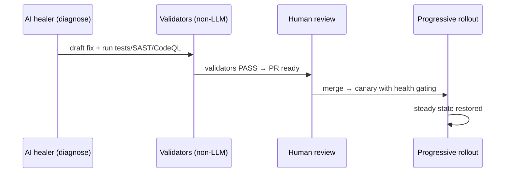

# Part 3 · The AI Era: What Actually Shipped (2024–2026)

*Series: [Overview](00-series-overview.md) · [Part 2](02-the-systems-layer.md) · **Part 3** · [Part 4](04-the-pulse-framework.md)*
**Audience:** engineers and buyers who need the frontier, not the press release · ~9 min · Video companion: [`docs/video/03-ai-era.mp4`](../video/03-ai-era.mp4) — 1:53 narrated

> 2025 was the year "AI SRE" became a **shipping product category** — and the industry converged, almost word for word, on the same safety line: *investigate autonomously, remediate through human gates.* [1][2][3][4]

## The product landscape, honestly labeled

Autonomy labels: **Advisory** (reads, explains) → **PR-gated** (writes code/config, human merges) → **Bounded actuation** (executes pre-approved reversible actions) → **Autonomous** (acts unattended).

| Product (vendor) | What it actually does (first-party pages) | Autonomy |
|---|---|---|
| Investigations (incident.io) | auto-investigates alerts, RCA with confidence + cited evidence, adversarial "challenger" — system changes **only via human-reviewed PR** | PR-gated (explicit) [2] |
| Bits AI family (Datadog) | investigates *every* alert, "production-ready" fixes + unit tests grounded in observability, 2,000+ prebuilt actions | Advisory → PR-gated [1] |
| SRE Agent suite (PagerDuty) | learns from incident history, self-updating runbooks, "recommends (and can execute) remediation steps" | Bounded actuation (claimed; oversight unspecified) [3] |
| Rootly AI | fire-time auto-investigation, code-set confidence, challenger agents, MCP tool-calls into Claude Code/Cursor | Advisory + tool calls [4] |
| AI SRE (Better Stack) | RCA across logs/metrics/traces; "never takes any automated actions without your approval" | PR-gated [5] |
| Traversal / Resolve AI | "primary on-call" agents; read-only by default / bounded rollbacks+capacity | Read-only → bounded [6][7] |
| Agentic autofix (GitHub) | Copilot fixes CodeQL alerts, **validates by re-running CodeQL**, opens draft PRs | PR-gated + self-validation [8] |
| Agent Fix (Snyk) | up to 5 candidate fixes per SAST issue, each pre-screened by re-running SAST | PR-gated + validation [9] |

**The category's honest frontier:** the only production actuation anyone defends is *reversible, pre-authorized action classes* — restart, rollback, scale. Nobody with published evidence runs L4 (unattended closed loop). Palo Alto's Cortex AgentiX promises it; no first-party deployment account exists yet [10].

## The research line behind the products

Two findings that shaped every product above:

1. **Structure beats raw autonomy.** A fixed localize→repair→validate *pipeline* (Agentless) beat elaborate agents at a fraction of the cost [11] — shipped products are structured pipelines, not free-roaming agents.
2. **The benchmark itself had to be audited.** OpenAI + the SWE-bench authors filtered **68.3%** of original samples (underspecified statements, unfair tests) to build the human-validated *Verified* split [12]. When a vendor quotes you a benchmark number, ask *which split, which scaffold, which date*.

And the capability trend that justifies building for more: METR measures the task length agents complete at 50% reliability **doubling every ~7 months** — but success still collapses beyond ~4-hour tasks today [13].

## AI as builder vs AI as healer

The distinction that determines architecture, risk, and ROI (full table in [`docs/research/00-synthesis.md` §3](../research/00-synthesis.md)):

- **AI as builder** — constructs the healing machinery *before* incidents: validated fix PRs [8][9], test improvement at scale (Meta's **TestGen-LLM**: 75% of generated tests built, **73% of recommendations accepted into production** [14]), self-updating runbooks [3], AI-written fuzz targets that found a 20-year-old OpenSSL bug [15]. **Production-proven and cheap.**
- **AI as healer** — acts *during* incidents: investigation is genuinely shipping [1][2][4]; remediation is bounded and gated [3][5][7]; the human Decide stage persists even at Anthropic, whose own reliability engineer states plainly that Claude "does not autonomously fix incidents" and confuses correlation with causation [16].

**The emerging consensus architecture** — visible in incident.io, GitHub autofix, and Cursor's internal automations alike:

> AI healer diagnoses → **builder validates** → human merges → platform rolls out with health-check gating [2][8][17].

## First-party evidence, including the failure you must read

- Anthropic runs "Claude Tag" as first responder on its own CI/CD: median **14-minute** situation reports, humans keep remediation control [16].
- The same source documents the field's most instructive failure: an agent with an over-broad filter **deleted ~200 workloads in 90 seconds** — an authorized action, executed unboundedly. The fixes were *infrastructure*: deletion-rate caps per hour/resource-kind/namespace, replenishing write budgets, an "undo test," agent-scoped identity. Not better prompts [16]. (This is OWASP's **Excessive Agency** risk made concrete [18] — see [Part 8](08-risks-anti-patterns-road-to-l4.md).)
- Google's DORA 2024: each +25% AI adoption correlated with a **−7.2%** change in delivery stability [19]. AI-accelerated shipping without expanded validation quietly *funds its own incident workload*. The hype discount is real — Gartner expects **>40% of agentic AI projects canceled by end-2027** [20].

## References & attribution

Full sourcing: [`docs/research/04-ai-era-and-business.md`](../research/04-ai-era-and-business.md)

1. Datadog, *Bits AI* — https://www.datadoghq.com/product/ai/ (incl. Bits Investigation)
2. incident.io, *Investigations* — https://incident.io/investigations
3. PagerDuty, *AI agent suite launch*, 2025 — https://www.pagerduty.com/newsroom/2025-fall-productlaunch/
4. Rootly, *Rootly AI* — https://rootly.com/ai
5. Better Stack, *AI SRE* — https://betterstack.com/ai-sre
6. Traversal — https://www.traversal.com/
7. Resolve AI — https://resolve.ai/
8. GitHub Changelog, *Agentic autofix GA*, 2026 — https://github.blog/changelog/2026-10-15-agentic-autofix-for-code-scanning-alerts-general-availability/
9. Snyk, *Building AI Trust with Snyk Code and Snyk Agent Fix*, 2025 — https://snyk.io/blog/building-ai-trust-with-snyk-code-and-snyk-agent-fix/
10. Palo Alto Networks, *Chronosphere acquisition + Cortex AgentiX*, 2025 — https://www.paloaltonetworks.com/company/press/2025/palo-alto-networks-to-acquire-chronosphere--next-gen-observability-leader--for-the-ai-era
11. Xia, Deng, Dunn & Zhang, *Agentless*, 2024 — https://arxiv.org/abs/2407.01489
12. OpenAI, *Introducing SWE-bench Verified*, Aug 2024 — https://openai.com/index/introducing-swe-bench-verified/
13. METR, *Measuring AI Ability to Complete Long Software Tasks*, 2025 — https://metr.org/blog/2025-03-19-measuring-ai-ability-to-complete-long-tasks
14. N. Alshahwan et al., *TestGen-LLM*, FSE 2024 — https://arxiv.org/abs/2402.09171
15. Google, *Leveling Up Fuzzing*, 2024 — https://security.googleblog.com/2024/11/leveling-up-fuzzing-finding-more.html
16. S. Malhotra (Anthropic), *Claude on call* + *Give the Agent a Budget*, 2026 — https://ai.engineer/speakers/sachin-malhotra; A. Palcuie (Anthropic), *Can Claude Fix Itself?*, QCon London 2026 via InfoQ — https://www.infoq.com/presentations/claude-sre-incidents/
17. Cursor, *Automations*, 2026 — https://cursor.com/blog/automations
18. OWASP, *Top 10 for LLM & GenAI Applications (2025)* — https://genai.owasp.org/initiatives/top-10-for-llm-and-genai/ (LLM06 Excessive Agency)
19. Google Cloud, *2024 DORA Report* — https://cloud.google.com/blog/products/devops-sre/announcing-the-2024-dora-report
20. Gartner, *>40% of agentic AI projects canceled by end-2027*, Jun 2025 — https://www.gartner.com/en/newsroom/press-releases/2025-06-25-gartner-predicts-over-40-percent-of-agentic-ai-projects-will-be-canceled-by-end-of-2027

**Next:** [Part 4 — the PULSE framework that turns all this into architecture →](04-the-pulse-framework.md)
