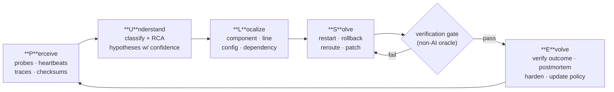
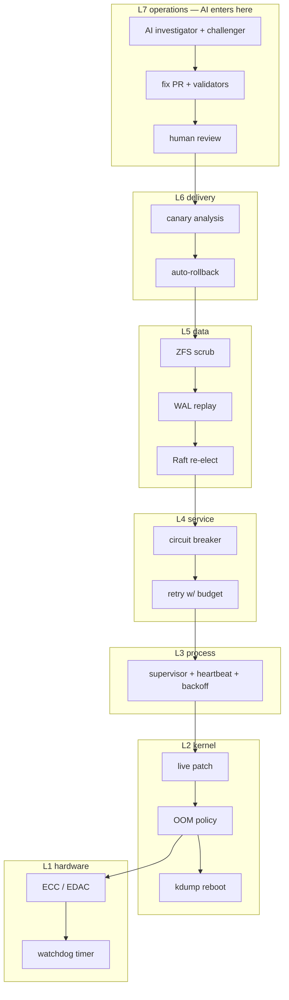
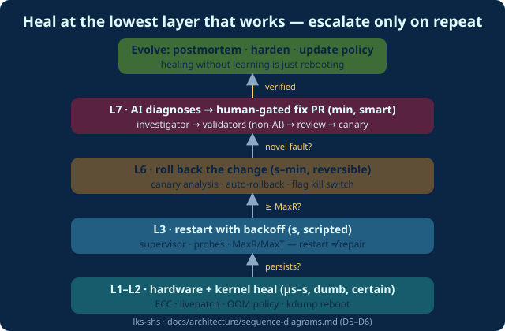

# Part 4 · The PULSE Framework

*Series: [Overview](00-series-overview.md) · [Part 3](03-the-ai-era-what-actually-shipped.md) · **Part 4** · [Part 5](05-pulse-in-python.md)*
**Audience:** architects, tech leads · ~10 min · Video companion: `docs/video/04-pulse-framework.mp4` *(renders in Phase 5)*

> **PULSE — Perceive · Understand · Localize · Solve · Evolve.** One loop, at every layer, from ECC memory to the incident channel. The name is literal: the heartbeat — dead-man's-switch, liveness probe, Raft heartbeat, `sd_notify` — is the one health primitive that exists at every layer of the stack. (*Why this name and not REPAIR/HEAL/CURE: five candidates, weighted trade-offs, in [Decision 001](../architecture/decisions/001-acronym.md).)*

## The loop, and why exactly five stages

Two stages are non-obvious and load-bearing:

- **Localize is separate from Understand.** The 2024 pipeline results showed fault *localization* is where cheap structure wins (Agentless's hierarchical search; AutoCodeRover's AST search) [1][2]. Folding it into "diagnose" hides the hardest problem in the loop.
- **The verification gate is a first-class boundary.** Nothing counts as healed until a *non-LLM* oracle — tests, SAST/CodeQL re-run, steady-state metrics, a golden request — says so. GitHub re-runs CodeQL before the PR [3]; Snyk re-runs SAST before showing a fix [4]; Meta's TestGen-LLM accepted 73% of recommendations *because* build+test filtered first [5]; SWE-bench requires FAIL_TO_PASS tests [6]. Axiom: *a fix that isn't verified is a guess.*

This is a direct descendant of **MAPE-K** (Kephart & Chess, 2003 — Monitor, Analyze, Plan, Execute over shared Knowledge) [7], with two additions the last 20 years forced: explicit localization, and an explicit oracle between acting and learning.

## The stack: same loop, seven layers

**The rule that makes the stack safe:** heal at the **lowest sufficient layer**; escalate upward only on repeated failure. That is literally what Erlang's restart intensity (MaxR/MaxT) [8], systemd's start limits [9], and kubelet's crash-loop backoff encode [10]. The animation below shows a fault climbing the ladder only when each layer's heal fails:

## The autonomy ladder is part of the architecture

| Rung | May do | May never do (yet) | Verified exemplar |
|---|---|---|---|
| **L0 Observe** | read telemetry | write anything | Bits Chat; Rootly MCP [11][12] |
| **L1 Investigate** | evidence-cited RCA | change systems | Claude Tag 14-min SITREPs [13] |
| **L2 Propose** | fix PRs after non-LLM validation | merge its own PR | agentic autofix [3] |
| **L3 Act (bounded)** | pre-authorized reversible actions, rate-capped | irreversible or novel actions | Resolve rollbacks [14]; Anthropic's rate caps [13] |
| **L4 Close the loop** | *(design for it)* | — claim it: **no verified deployment exists** [15] |

Advance an action class one rung at a time, gated on measured MTTR deltas and audit findings. Buying autonomy before audit trails is the procurement anti-pattern [16].

## The seven binding rules

1. Heal at the lowest sufficient layer; escalate on repeat.
2. The verification gate is mandatory — no non-AI oracle, no "healed."
3. The healer is bounded: backoff schedules, MaxR/MaxT, action budgets, rate caps **enforced in infrastructure, not prompts** [13].
4. Oracles must be out-of-band: heartbeat (liveness) + golden request (correctness); self-reported health is not an oracle.
5. Diagnosis may be autonomous; code-change is PR-gated; actuation only for pre-authorized reversible classes [3][4][16].
6. Every heal is an Evolve artifact — logged with MTTR, triage, postmortem hook. *Healing without learning is just rebooting.*
7. Declare desired state wherever possible — reconciliation beats imperative repair scripts [17][18].

Full architecture with component model and both playbook instantiations: [`docs/architecture/reference-architecture.md`](../architecture/reference-architecture.md) · All six sequence diagrams: [`sequence-diagrams.md`](../architecture/sequence-diagrams.md) · Patterns indexed by stage: [`pattern-catalog.md`](../architecture/pattern-catalog.md).

## References & attribution

1. Xia et al., *Agentless* (hierarchical localization), 2024 — https://arxiv.org/abs/2407.01489
2. Zhang et al., *AutoCodeRover*, ISSTA 2024 — https://arxiv.org/abs/2404.05427
3. GitHub, *Agentic autofix GA* (CodeQL validation), 2026 — https://github.blog/changelog/2026-10-15-agentic-autofix-for-code-scanning-alerts-general-availability/
4. Snyk, *Agent Fix* (SAST pre-screening), 2025 — https://snyk.io/blog/building-ai-trust-with-snyk-code-and-snyk-agent-fix/
5. Alshahwan et al., *TestGen-LLM*, FSE 2024 — https://arxiv.org/abs/2402.09171
6. Jimenez et al., *SWE-bench*, ICLR 2024 — https://arxiv.org/abs/2310.06770
7. Kephart & Chess, *The Vision of Autonomic Computing*, 2003 — https://doi.org/10.1109/MC.2003.1160055
8. Erlang/OTP docs, *Supervision Principles* — https://www.erlang.org/doc/design_principles/sup_princ.html
9. freedesktop, *systemd.service(5)* — https://www.freedesktop.org/software/systemd/man/latest/systemd.service.html
10. Kubernetes docs, *Pod Lifecycle* — https://kubernetes.io/docs/concepts/workloads/pods/pod-lifecycle/
11. Datadog, *Bits AI* — https://www.datadoghq.com/product/ai/
12. Rootly, *Rootly AI* (MCP) — https://rootly.com/ai
13. S. Malhotra (Anthropic), 2026 — https://ai.engineer/speakers/sachin-malhotra
14. Resolve AI — https://resolve.ai/
15. Palo Alto Networks / Cortex AgentiX (announced; no first-party deployment account) — see dossier 04 negative results
16. OWASP Top 10 for LLM & GenAI 2025 (LLM06 Excessive Agency) — https://genai.owasp.org/initiatives/top-10-for-llm-and-genai/
17. Verma et al., *Borg*, EuroSys 2015 — https://research.google/pubs/large-scale-cluster-management-at-google-with-borg/
18. Kubernetes docs, *What is Kubernetes* — https://kubernetes.io/docs/concepts/overview/what-is-kubernetes/

**Next:** [Part 5 — the framework running in ~600 lines of Python →](05-pulse-in-python.md)
